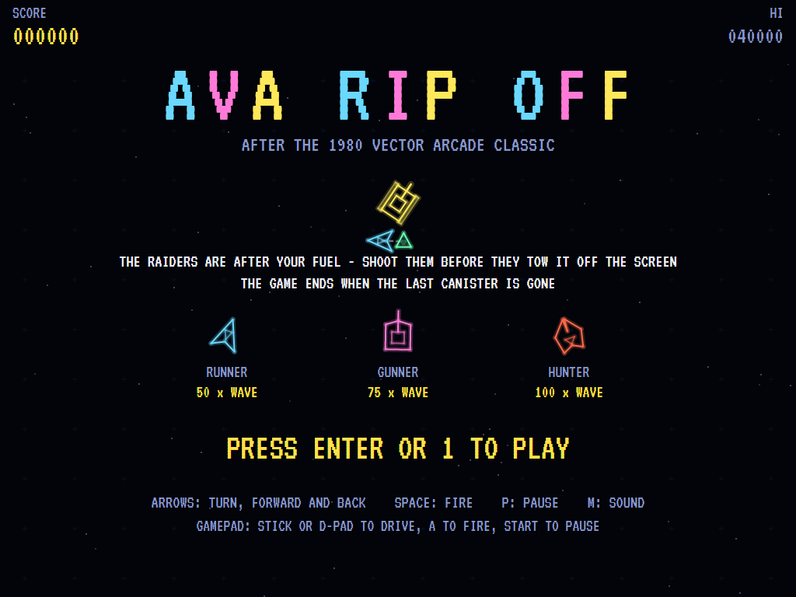
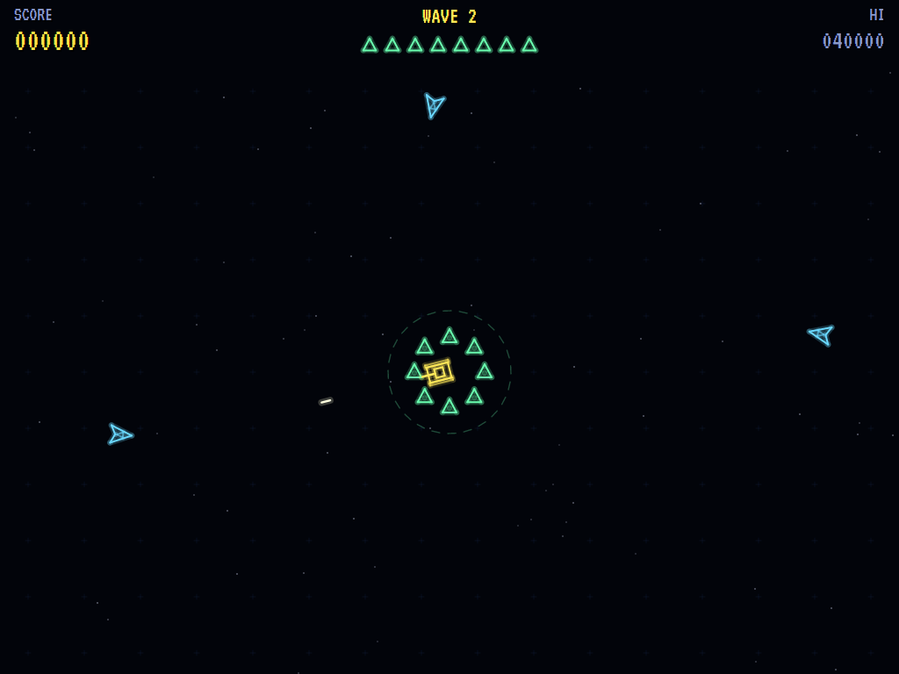
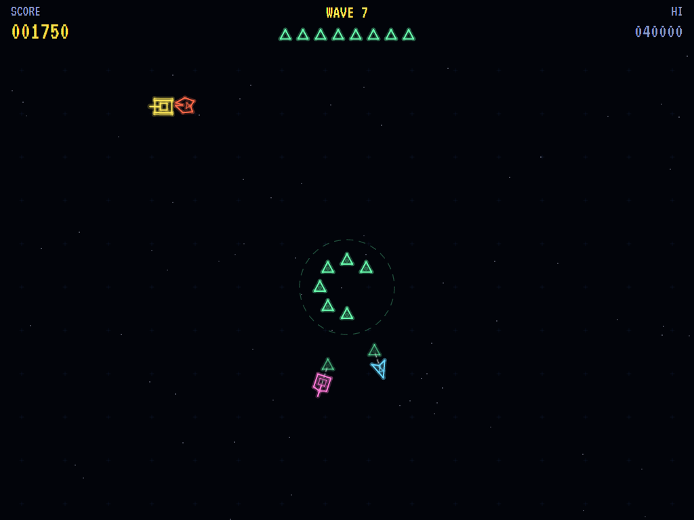
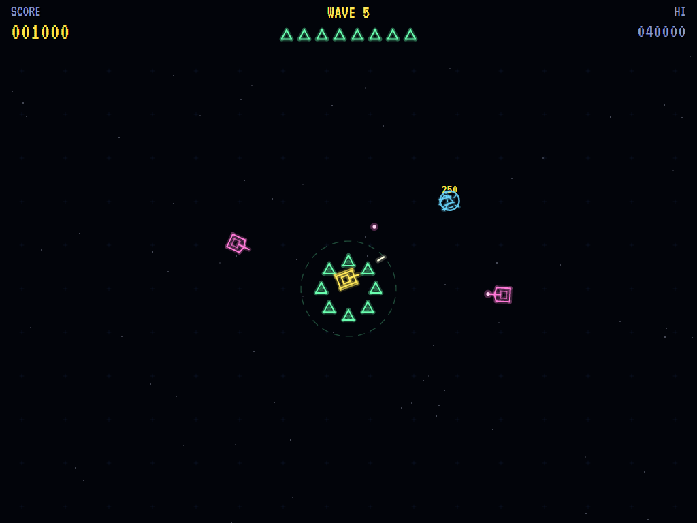
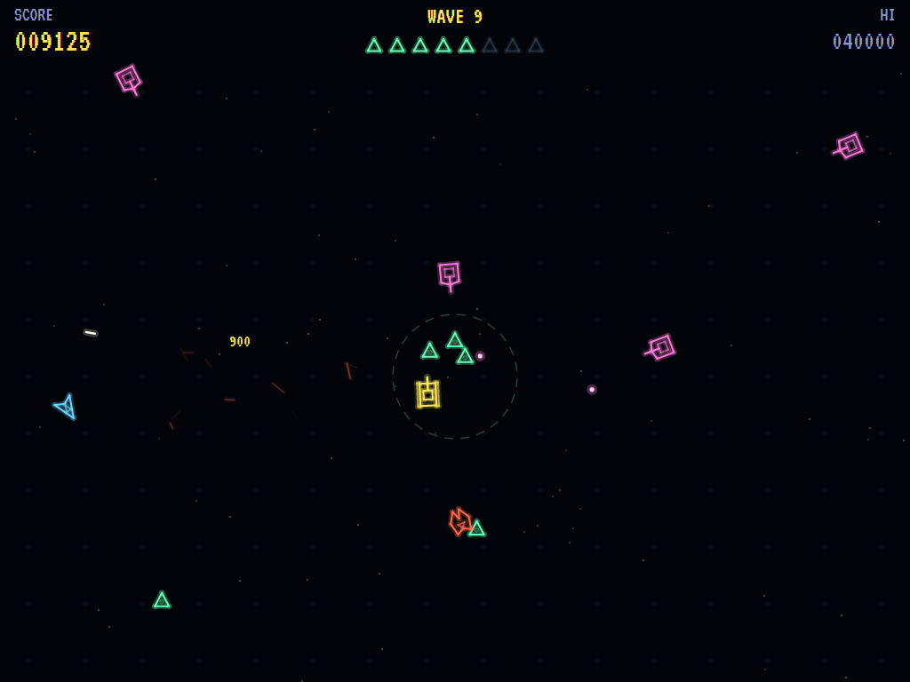
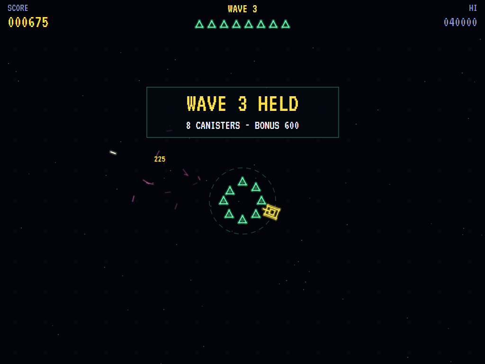
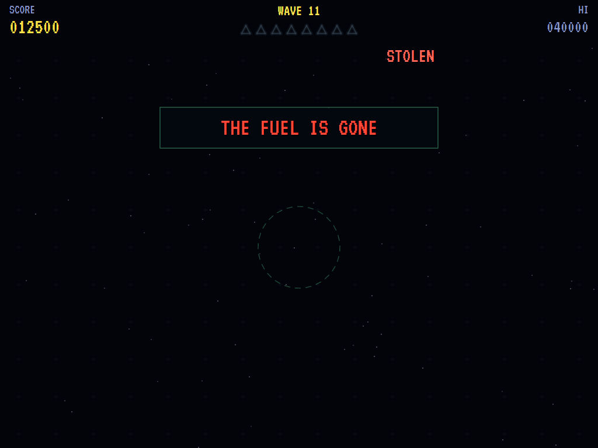
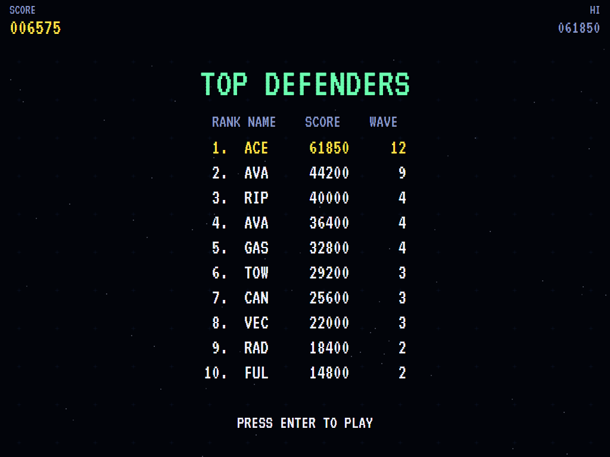

# AVA Rip Off

[](https://github.com/Harlock123/AVARipOff/actions/workflows/build.yml)

A colour vector game in the style of Cinematronics' 1980 arcade game **Rip Off**, built with .NET 10 and
Avalonia UI. Eight fuel canisters stand in a depot in the middle of an open plain. Raiders come in from
every side at once to hook them and tow them off the edge of the screen. You have one tank, and you can't
be everywhere: shoot the raider dragging a canister away before it gets there. There are no lives. You can
lose your tank as often as you like, and the raiders get a free run until it's back. The game ends when the
last canister is gone.

## Features

- **The tank** turns on the spot, drives forward and back, and fires straight ahead, two shells at a time.
- **The fuel**: eight canisters round the depot.
  - A raider hooks one and tows it on a line the shortest way off the screen, slower with the weight behind
    it. An alarm sounds while any canister is in tow.
  - Shoot the raider and the canister drops where it was. It stays there, out in the open, for the next
    raider to come for.
  - Raiders spread themselves across the canisters rather than all going for one.
- **The raiders** come in together, from every side, weaving as they close in. They're worth more the more
  dangerous they are, multiplied by the wave:
  - **Runners** (50) are quick and unarmed: they want the fuel and nothing else.
  - **Gunners** (75), from the third wave, go for the fuel too. They charge the tank when it comes near and
    fire when it's in front of them.
  - **Hunters** (100), from the fifth wave, go for the tank first. They ram it or shoot it, and only then
    turn to the fuel.
- **Losing the tank** costs nothing but time. It comes back at the depot, safe for a moment, once no raider
  is standing on it.
- **Each wave** brings more raiders, quicker, firing more often. Holding a wave pays a bonus for the fuel
  left. Canisters don't come back.
- **The attract mode** plays itself. The computer player shoots first whatever is about to tow a canister off
  the edge, leads every shot, and swerves out of the way of shots and rams.
- **The sounds** are all synthesised: the tank's thump, the raiders' zap, the clank of a hook, a two-tone
  alarm, a canister lost, and a stalking title theme.

## Screenshots

| The title | The raiders come in | Canisters in tow |
|:---------:|:-------------------:|:----------------:|
|  |  |  |
| The three kinds of raider. | From every side at once. | Away to the edge. |

| Gunners | A hunter | A wave held |
|:-------:|:--------:|:-----------:|
|  |  |  |
| Firing back. | Coming for the tank. | The bonus for the fuel left. |

| The fuel gone | The high scores | |
|:-------------:|:---------------:|:-:|
|  |  | |
| The last canister towed away. | The top defenders. | |

The screenshots are made by the tests, which play the game in a real (headless) window; see
[Tests](#tests).

## Download and run

Ready-to-run builds for Windows, macOS and Linux, on both Intel/AMD and ARM, are on the
[Releases page](https://github.com/Harlock123/AVARipOff/releases/tag/latest). **Latest build** is
rebuilt on every push to `main`. Each download is one self-contained executable: no .NET install is
needed.

| Platform | Archive |
|---|---|
| Windows | `AVARipOff-win-x64.zip`, `AVARipOff-win-x86.zip`, `AVARipOff-win-arm64.zip` |
| macOS | `AVARipOff-osx-arm64.tar.gz` (Apple silicon), `AVARipOff-osx-x64.tar.gz` (Intel) |
| Linux | `AVARipOff-linux-x64.tar.gz`, `AVARipOff-linux-arm64.tar.gz`, `AVARipOff-linux-arm.tar.gz` |

```bash
tar -xzf AVARipOff-linux-x64.tar.gz     # or linux-arm64, linux-arm, osx-arm64, osx-x64
./AVARipOff
```

On Windows, unzip and run `AVARipOff.exe`. On macOS, if Gatekeeper refuses to open it, run
`xattr -d com.apple.quarantine AVARipOff` once. Run with `--no-audio` for silence.

**Sound** comes through OpenAL Soft, built in for every platform. In a virtual machine the game
detects it and uses a larger audio buffer, so the sound doesn't break up.

**Gamepads** use SDL2, which is bundled for Windows, macOS and Intel/AMD Linux. ARM Linux builds need it
installed; without it the keyboard still works:

```bash
sudo apt install libsdl2-dev            # Debian / Ubuntu / Raspberry Pi OS
sudo pacman -S --needed sdl2-compat     # Arch / Omarchy
```

## Controls

| Action | Keyboard | Gamepad |
|---|---|---|
| Start | Enter or 1 | Start |
| Turn | Left / Right (or A / D) | Left stick / D-pad |
| Drive forward / back | Up / Down (or W / S) | Up / Down (or B for forward) |
| Fire | Space, Z, X or Ctrl | A, X or right trigger |
| Pause | P or Esc | Start |
| Quit (while paused) | Esc | Back |
| Sound on/off | M | |
| Screenshot | Ctrl+S (to your Pictures folder) | |

On the high-score table, type your initials, or use up/down and Space, then Enter.

## Tests

```bash
dotnet test AVARipOff.slnx
```

The engine has no UI and runs in fixed 60 Hz steps, so it plays the same at any frame rate, and a seed
always plays the same game. The tests check:

- **The depot and the tank:**
  - the ring of canisters with the tank in the middle
  - turning, speed, coasting, reversing, and staying on the screen
  - two shots at a time, only so far
- **The raiders:**
  - points by kind and wave
  - hooking the nearest canister, towing it slower on its line and off the screen for good
  - a shot tower dropping its canister for another to take
  - raiders spreading over the canisters
  - gunners firing at the tank in front of them (and runners never)
  - a hunter ramming the tank, and the tank coming back safe at the depot (but not while a raider is there)
  - more raiders each wave, together from every side, and the dangerous kinds as the waves go on
- **The machine:**
  - a wave held, with its bonus
  - the last canister ending the game
  - the alarm while one is in tow
  - initials for a high score
  - the title, demonstration and high scores
  - starting a game
  - the computer player holding the first wave
  - the same game from the same seed, and pausing

The screenshot tests draw the real screen in a headless window. To refresh the README's pictures:

```bash
RIPOFF_SHOTS=$PWD/Images dotnet test tests/AVARipOff.Tests --filter ScreenshotTests
```

To see how the computer player gets on, wave by wave (for tuning; `1` for the pilot, `lazy` for one that just
sits at the depot turning and firing):

```bash
RIPOFF_PROBE=1 dotnet test tests/AVARipOff.Tests --filter PilotProbe --logger "console;verbosity=detailed"
```

## Building

```bash
dotnet build AVARipOff.slnx
dotnet run --project src/AVARipOff
```

Needs the .NET 10 SDK. The sounds are made by `tools/make_sounds.py` (standard-library Python):
`python3 tools/make_sounds.py` rewrites `src/AVARipOff/Sounds`.

## Project structure

```
AVARipOff/
├── AVARipOff.slnx
├── src/AVARipOff/
│   ├── Engine/
│   │   ├── GameEngine.cs        # States, the title and demo cycle, the alarm
│   │   ├── GameEngine.Play.cs   # The tank and its shells; the raiders, their hooks and tows; waves and
│   │   │                        # scoring
│   │   ├── TankPilot.cs         # The computer player, for the demonstration (and the tests)
│   │   ├── Entities.cs          # The plain, the tank, the canisters and the raiders
│   │   ├── HighScoreTable.cs, InitialsEntry.cs
│   │   ├── InputHandler.cs, ControllerManager.cs  # Keys and an SDL2 gamepad
│   │   └── SoundManager.cs      # Effects and the tunes through OpenAL
│   ├── Audio/                   # The OpenAL engine (from the author's AVABand)
│   ├── Views/                   # The vector drawing: the depot, tank, raiders, tow lines and the screens
│   └── Sounds/                  # The synthesised effects and tunes
├── tests/AVARipOff.Tests/       # Gameplay, screenshot and probe tests
├── tools/make_sounds.py
└── Images/                      # Screenshots
```

## About and licence

AVA Rip Off © 2026 Lonnie Watson, under the [MIT License](LICENSE).

*Rip Off* © 1980 Cinematronics; the name belongs to its current owner. AVA Rip Off is an independent,
unofficial game in its style. Its tank, raiders and depot, its graphics, sounds, tunes and code are its own;
nothing is taken from the arcade machine's program, graphics, sound or music. It is not affiliated with or
endorsed by any rights holder.
